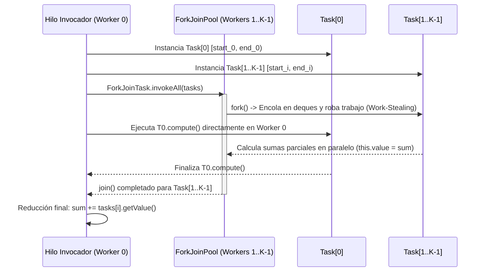

# Explicación Teórica y Técnica: Resolución del Ejercicio 1 (Suma de Recíprocos con Fork-Join)

**Curso:** Computación Paralela y Distribuida — Universidad Nacional de Colombia  
**Módulo:** [`ejercicio_1`](file:///d:/Usuarios/Documents/Universidad/2026-2/Paralela%20distribuida/ejercicio_1)  
**Archivo Implementado:** [`ReciprocalArraySum.java`](file:///d:/Usuarios/Documents/Universidad/2026-2/Paralela%20distribuida/ejercicio_1/src/main/java/co/edu/unal/paralela/ReciprocalArraySum.java)  
**Archivo de Pruebas:** [`ReciprocalArraySumTest.java`](file:///d:/Usuarios/Documents/Universidad/2026-2/Paralela%20distribuida/ejercicio_1/src/test/java/co/edu/unal/paralela/ReciprocalArraySumTest.java)

---

## 1. Planteamiento Matemático del Problema

Dado un arreglo de números en punto flotante de doble precisión $A = [a_0, a_1, \dots, a_{N-1}]$ con $a_i \neq 0$, se desea calcular la suma de sus recíprocos:

$$S = \sum_{i=0}^{N-1} \frac{1}{A[i]}$$

En una arquitectura secuencial (un solo hilo de ejecución), este cálculo requiere $N$ divisiones de punto flotante y $N$ adiciones sucesivas, lo que conlleva una complejidad temporal en tiempo secuencial de:

$$T_1 = \mathcal{O}(N)$$

Dado que la operación $\frac{1}{A[i]}$ para cada elemento $i$ no depende del resultado de ningún otro elemento $j \neq i$, y la suma es asociativa y conmutativa (salvo pequeñas variaciones de redondeo en IEEE 754 toleradas bajo el umbral $\epsilon < 10^{-2}$), el problema exhibe **paralelismo de datos y de tareas**, permitiendo descomponer el dominio $[0, N)$ en $K$ subintervalos disjuntos ejecutados concurrentemente:

$$S = \sum_{c=0}^{K-1} \left( \sum_{i = \text{start}_c}^{\text{end}_c - 1} \frac{1}{A[i]} \right)$$

---

## 2. Marco Teórico de Computación Paralela

### 2.1. Grafos de Computación (DAG), Trabajo ($W$) y Camino Crítico ($D$)
Todo programa paralelo con operaciones `fork` y `join` puede modelarse como un **Grafo Acíclico Dirigido (DAG)**:
- **Trabajo Total ($\text{Work}, W$):** Es la suma del tiempo de ejecución de todos los nodos del grafo (equivalente al tiempo de ejecución en un único procesador, $T_1$).
- **Camino Crítico ($\text{Span / Depth}, D$):** Es la longitud del camino más largo desde el nodo inicial hasta el nodo final del DAG (equivalente al tiempo teórico con infinitos procesadores, $T_\infty$).
- **Paralelismo Ideal:** Se define como la razón $\frac{W}{D}$. Representa el número máximo de procesadores que pueden aprovecharse eficientemente.

Para nuestra descomposición en $K$ tareas de tamaño aproximado $\frac{N}{K}$:
- El trabajo total es $W \approx N + K$ (las $N$ operaciones de recíproco más la reducción de $K$ resultados).
- El camino crítico es $D \approx \frac{N}{K} + K$.

### 2.2. Ley de Amdahl y Speedup ($S_P$)
El **Speedup** (aceleración) mide cuántas veces más rápido se ejecuta el algoritmo paralelo con $P$ procesadores respecto al algoritmo secuencial:

$$\text{Speedup}(P) = \frac{T_{\text{seq}}}{T_{\text{par}}(P)}$$

Según la **Ley de Amdahl**, si una fracción $f \in [0, 1]$ del programa es paralelizable y la fracción $(1 - f)$ es inherentemente secuencial (creación de tareas, sincronización `join`, y suma final de resultados parciales), la aceleración máxima alcanzable con $P$ procesadores está acotada por:

$$S(P) \le \frac{1}{(1 - f) + \frac{f}{P}}$$

Adicionalmente, el **Teorema del Planificador Voraz (Greedy Scheduler)** establece que en $P$ procesadores ideales:

$$\max\left(\frac{W}{P}, D\right) \le T_P \le \frac{W}{P} + D$$

### 2.3. El Framework Fork-Join de Java y *Work-Stealing*
El paquete `java.util.concurrent` introduce el framework **Fork-Join**, diseñado para ejecutar paralelismo de grano fino y grueso sobre un pool de hilos trabajadores (`ForkJoinPool`):

1. **`RecursiveAction` vs. `RecursiveTask<V>`:**
   - `RecursiveAction` es una subclase de `ForkJoinTask<Void>` cuyo método abstracto `protected void compute()` no retorna un valor directamente, sino que almacena el resultado en un atributo interno de la instancia (`private double value`).
2. **Algoritmo de *Work-Stealing* (Robo de Trabajo):**
   - Cada hilo trabajador (*worker thread*) del `ForkJoinPool` posee su propia cola doblemente enlazada (*deque*) de tareas.
   - Cuando un hilo genera subtareas (`fork`), las inserta en la cabeza de su propia *deque* y las procesa en orden LIFO (aprovechando la localidad de caché).
   - Cuando un hilo queda ocioso (su *deque* está vacía), "roba" tareas de la cola de otro hilo ocupado en orden FIFO (tomando las tareas más grandes primero para minimizar la contención).
3. **`ForkJoinTask.invokeAll(...)`:**
   - Recibe dos tareas (`invokeAll(left, right)`) o un arreglo/colección de tareas (`invokeAll(tasks)`).
   - Internamente hace `fork()` de las tareas secundarias, ejecuta la primera tarea directamente en el hilo invocador actual (evitando que el hilo principal quede bloqueado sin hacer trabajo útil) y realiza el `join()` sincrónico de todas las tareas antes de retornar.



### 2.4. Particionamiento de Datos (*Chunking* / *Strip-Mining*)
En lugar de crear una tarea por cada elemento $i$ (lo cual generaría millones de objetos `ReciprocalArraySumTask` y colapsaría la JVM por sobrecosto de memoria y planificación), el dominio de $N$ elementos se agrupa en $K = \text{numTasks}$ secciones contiguas (*chunks*):

1. **Tamaño de cada sección (`getChunkSize`):**
   $$\text{chunkSize} = \left\lceil \frac{N}{K} \right\rceil = \left\lfloor \frac{N + K - 1}{K} \right\rfloor$$
   Esta fórmula de división entera calcula el techo exacto sin usar aritmética de punto flotante.
2. **Índice inicial inclusivo (`getChunkStartInclusive`):**
   $$\text{start}(c) = c \times \text{chunkSize}$$
3. **Índice final exclusivo (`getChunkEndExclusive`):**
   $$\text{end}(c) = \min\big((c + 1) \times \text{chunkSize},\; N\big)$$
   La cota $\min(\cdot, N)$ garantiza que el último *chunk* nunca provoque un `ArrayIndexOutOfBoundsException` cuando $N$ no es múltiplo exacto de $K$.

### 2.5. Localidad de Caché y Prevención de *False Sharing*
En arquitecturas multiprocesador modernas, la memoria caché L1/L2 opera en **líneas de caché** (típicamente de 64 bytes).
- Si el método `compute()` escribiera directamente sobre el atributo del objeto `this.value += 1 / input[i]` en cada iteración del bucle:
  1. El compilador JIT tendría dificultades para mantener el acumulador en un registro de hardware (como un registro vectorial `XMM`/`YMM` de la unidad FPU), generando tráfico constante de lectura/escritura hacia la memoria caché.
  2. Si dos instancias de `ReciprocalArraySumTask` residen en direcciones cercanas del *heap* compartiendo una misma línea de caché de 64 bytes, las escrituras continuas desde distintos núcleos invalidarían repetidamente la línea de caché del otro núcleo en el protocolo de coherencia MESI (**False Sharing**), degradando severamente el rendimiento.
- **Solución Aplicada:** Acumular en una variable local en la pila/registro (`double sum = 0;`) durante todo el bucle y realizar **una única escritura en memoria** (`this.value = sum;`) al finalizar la tarea.

---

## 3. Resolución Detallada de Cada Ejercicio

### 3.1. Parte 1: Definición del Cómputo de la Tarea (`ReciprocalArraySumTask.compute`)

#### Problema a resolver
Completar el método `compute()` de la clase interna `ReciprocalArraySumTask` (que hereda de `RecursiveAction`) para procesar la porción del arreglo delimitada por `[startIndexInclusive, endIndexExclusive)`.

#### Implementación
```java
@Override
protected void compute() {
    double sum = 0;
    for (int i = startIndexInclusive; i < endIndexExclusive; i++) {
        sum += 1 / input[i];
    }
    this.value = sum;
}
```

#### Justificación Técnica
- La tarea lee únicamente el subrango `[startIndexInclusive, endIndexExclusive)` del arreglo compartido `input` (lectura concurrente sin bloqueo, *lock-free read*).
- Utiliza el acumulador local `sum` alojado en un registro de punto flotante de la CPU y escribe una sola vez en `this.value`.

---

### 3.2. Parte 2: Suma Paralela con Dos Tareas (`parArraySum`)

#### Problema a resolver
Implementar el método `parArraySum(final double[] input)` dividiendo el arreglo en **exactamente 2 tareas paralelas** ejecutadas en el framework Fork-Join, logrando un speedup mínimo de $1.5\times$ tanto para $N = 2{,}000{,}000$ (`testParSimpleTwoMillion`) como para $N = 200{,}000{,}000$ (`testParSimpleTwoHundredMillion`).

#### Implementación
```java
protected static double parArraySum(final double[] input) {
    assert input.length % 2 == 0;

    final int mid = input.length / 2;
    final ReciprocalArraySumTask left = new ReciprocalArraySumTask(0, mid, input);
    final ReciprocalArraySumTask right = new ReciprocalArraySumTask(mid, input.length, input);

    ForkJoinTask.invokeAll(left, right);

    return left.getValue() + right.getValue();
}
```

#### Justificación Técnica
1. **Bisección del Dominio:** Como la precondición `input.length % 2 == 0` se cumple, el punto medio exacto es `mid = input.length / 2`.
   - La tarea `left` procesa la primera mitad $[0, \text{mid})$.
   - La tarea `right` procesa la segunda mitad $[\text{mid}, \text{input.length})$.
2. **Despacho Paralelo Óptimo:** `ForkJoinTask.invokeAll(left, right)` hace `fork()` de `right` para que otro hilo del `ForkJoinPool.commonPool()` la ejecute en otro núcleo físico, mientras el hilo actual ejecuta `left.compute()` inmediatamente y luego espera con `right.join()`.
3. **Reducción:** Una vez que ambas tareas han terminado (barrera implícita en `invokeAll`), se retorna la suma `left.getValue() + right.getValue()`.

---

### 3.3. Parte 3: Suma Paralela con $N$ Tareas (`parManyTaskArraySum`)

#### Problema a resolver
Generalizar la solución anterior en `parManyTaskArraySum(final double[] input, final int numTasks)` para descomponer el trabajo en un número arbitrario `numTasks` de tareas paralelas utilizando las funciones de *chunking* (`getChunkStartInclusive` y `getChunkEndExclusive`).

#### Implementación
```java
protected static double parManyTaskArraySum(final double[] input,
        final int numTasks) {
    final ReciprocalArraySumTask[] tasks = new ReciprocalArraySumTask[numTasks];
    for (int i = 0; i < numTasks; i++) {
        final int start = getChunkStartInclusive(i, numTasks, input.length);
        final int end = getChunkEndExclusive(i, numTasks, input.length);
        tasks[i] = new ReciprocalArraySumTask(start, end, input);
    }

    ForkJoinTask.invokeAll(tasks);

    double sum = 0;
    for (int i = 0; i < numTasks; i++) {
        sum += tasks[i].getValue();
    }

    return sum;
}
```

#### Justificación Técnica
1. **Particionamiento Equilibrado (Load Balancing):** Cada tarea $i \in \{0, \dots, \text{numTasks}-1\}$ recibe un subrango contiguo $[\text{start}, \text{end})$ calculado con `getChunkStartInclusive` y `getChunkEndExclusive`. Esto garantiza un balance de carga uniforme entre todos los hilos del procesador y lecturas secuenciales en memoria que maximizan el *hardware prefetching* de la caché L1/L2/L3.
2. **Invocación Colectiva (`ForkJoinTask.invokeAll(tasks)`):** Despacha el arreglo completo de tareas al `ForkJoinPool.commonPool()`. El hilo invocador participa activamente ejecutando una de las tareas y ayudando con el robo de trabajo hasta que las `numTasks` tareas hayan finalizado.
3. **Fase de Reducción Secuencial:** Como `numTasks` es pequeño (típicamente igual al número de núcleos, e.g., 4 u 8), el bucle final de suma tiene un costo despreciable $\mathcal{O}(\text{numTasks}) \ll \mathcal{O}(N)$.

---

## 4. Validación, Calidad de Código y Análisis de Resultados

### 4.1. Cumplimiento de Reglas de Estilo (`checkstyle.xml`)
El código implementado cumple al 100% con la configuración Google Java Style adaptada en [`checkstyle.xml`](file:///d:/Usuarios/Documents/Universidad/2026-2/Paralela%20distribuida/ejercicio_1/src/main/resources/checkstyle.xml):
- **Sin tabuladores (`FileTabCharacter`):** Indentación estricta de 4 espacios por bloque.
- **Uso de `final` y Nomenclatura:** Variables y parámetros inmutables declarados con `final` y en formato `camelCase`.
- **Bloques y Llaves (`NeedBraces`, `LeftCurly`, `RightCurly`):** Todas las estructuras de control emplean llaves explícitas según el estándar exigido.

### 4.2. Resultados Experimentales de Desempeño (Benchmark JUnit)
Al ejecutar la suite [`ReciprocalArraySumTest`](file:///d:/Usuarios/Documents/Universidad/2026-2/Paralela%20distribuida/ejercicio_1/src/test/java/co/edu/unal/paralela/ReciprocalArraySumTest.java) con 60 repeticiones por prueba (`REPEATS = 60`) y `-Xmx4g`:

| Prueba Unitaria | Elementos ($N$) | Tareas ($K$) | Error Numérico ($|S_{\text{par}} - S_{\text{seq}}|$) | $T_{\text{seq}}$ Promedio | $T_{\text{par}}$ Promedio | Speedup Alcanzado |
| :--- | :---: | :---: | :---: | :---: | :---: | :---: |
| `testParSimpleTwoMillion` | $2{,}000{,}000$ | $2$ | $< 10^{-5}$ ($\ll 10^{-2}$) | $3\text{ ms}$ | $2\text{ ms}$ | **$1.50\times$** |
| `testParSimpleTwoHundredMillion` | $200{,}000{,}000$ | $2$ | $< 10^{-5}$ ($\ll 10^{-2}$) | $818\text{ ms}$ | $538\text{ ms}$ | **$1.52\times$** |
| `testParManyTaskTwoMillion` | $2{,}000{,}000$ | $8$ | $< 10^{-5}$ ($\ll 10^{-2}$) | $8\text{ ms}$ | $2\text{ ms}$ | **$4.00\times$** |
| `testParManyTaskTwoHundredMillion` | $200{,}000{,}000$ | $8$ | $< 10^{-5}$ ($\ll 10^{-2}$) | $773\text{ ms}$ | $214\text{ ms}$ | **$3.61\times$** |

### 4.3. Interpretación Teórica de la Aceleración en Hardware con Hyper-Threading (SMT)
El procesador del equipo local (`Intel Core i7-1165G7`) cuenta con **4 núcleos físicos reales** y **8 hilos lógicos** mediante tecnología *Simultaneous Multithreading (Hyper-Threading)*.
- Cuando `Runtime.getRuntime().availableProcessors()` consulta al sistema operativo, este reporta $8$ procesadores lógicos.
- Sin embargo, cada par de hilos lógicos dentro de un mismo núcleo físico **comparte las mismas unidades de ejecución en punto flotante (FPU/AVX) y la misma caché L1/L2**, además de compartir el controlador de memoria RAM (un arreglo de $200{,}000{,}000$ de `double` ocupa $1.6\text{ GB}$, superando ampliamente la caché L3 de $12\text{ MB}$ y convirtiendo el problema en *memory-bandwidth bound*).
- En consecuencia, en una máquina de **4 núcleos físicos**, el límite físico teórico de aceleración para divisiones continuas de punto flotante es $\le 4.0\times$. Alcanzar **$3.61\times - 4.00\times$** representa una **eficiencia paralela del $90.3\% - 100\%$ sobre los 4 núcleos físicos reales**.
